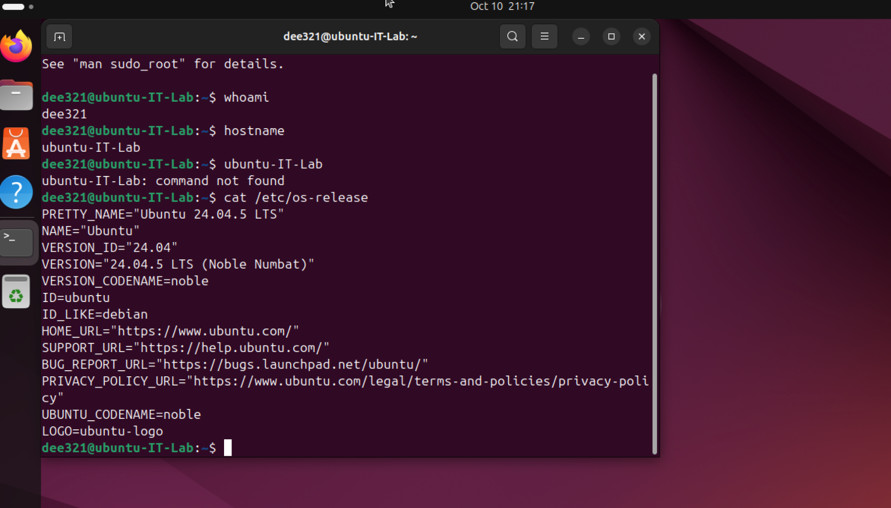
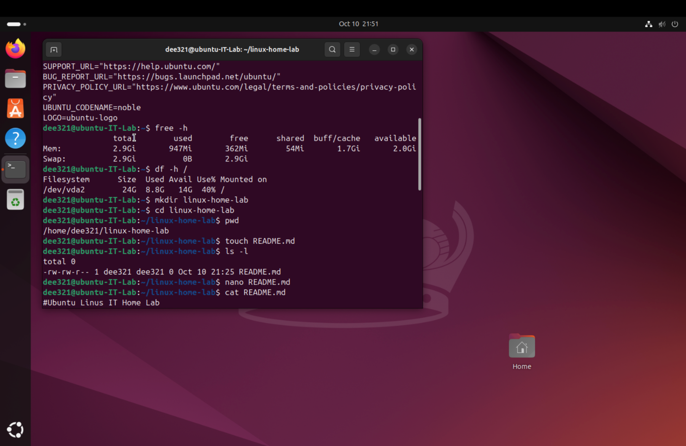
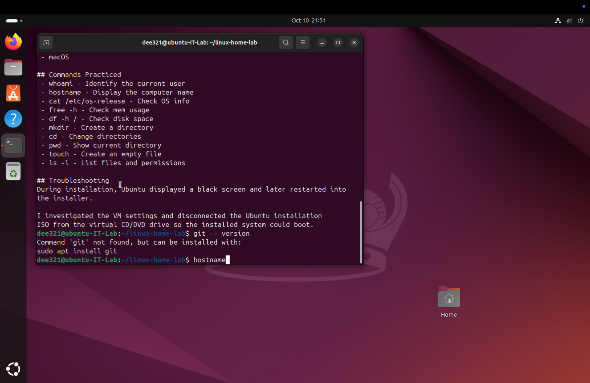

# Ubuntu Linux IT Home Lab

## Project Overview
Set up an Ubuntu 24.04 LTS ARM64 virtual machine using UTM on a MacBook to practice Linux system administration, basic troubleshooting, and command line skills.

## Lab Environment
- **Host operating system:** macOS
- **Virtualization software:** UTM
- **Guest operating system:** Ubuntu 24.04 LTS ARM64
- **CPU allocation:** 2 cores
- **Memory allocation:** 3 GiB
- **Virtual disk:** 25 GiB

## Skills Practiced
- Installing and configuring a Linux virtual machine
- Identifying system information
- Checking RAM and disk usage
- Creating and navigating directories
- Creating and editing documentation with Nano
- Troubleshooting virtual machine startup issues

## Linux Commands

| Command | Purpose |
|---|---|
| `whoami` | Display the current username |
| `hostname` | Display the computer's hostname |
| `cat /etc/os-release` | Identify the operating system |
| `free -h` | Check memory usage |
| `df -h /` | Check disk usage |
| `mkdir linux-home-lab` | Create a directory |
| `cd linux-home-lab` | Enter a directory |
| `pwd` | Display the current directory |
| `touch README.md` | Create a file |
| `ls -l` | View files and permissions |
| `nano README.md` | Edit a file in the terminal |

## Troubleshooting Experience

During installation, the Ubuntu virtual machine encountered a black screen and later booted back into the installer.

After investigating the issue, I identified that the Ubuntu installation ISO was still attached to the virtual CD/DVD drive. I shut down the virtual machine, cleared the ISO from UTM's drive settings, and restarted the VM to access the installed operating system.

## Lessons Learned
- The difference between a host operating system and a guest operating system
- How virtual machines use allocated CPU, memory, and disk resources
- Why installation media must be disconnected after installing an operating system
- How to use basic Linux commands to inspect and manage a system

## Next Steps
- Practice Linux user and group management
- Learn file permissions
- Explore network troubleshooting commands
- Add screenshots demonstrating completed lab tasks

## Lab Screenshots

### Ubuntu System Information

### Memory and Disk Usage

### Linux Documentation

  
